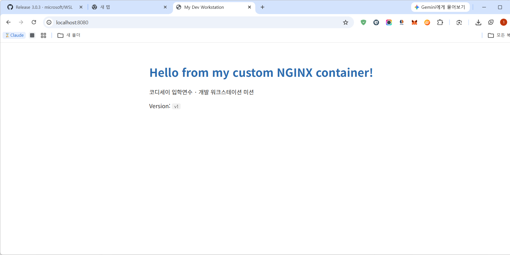
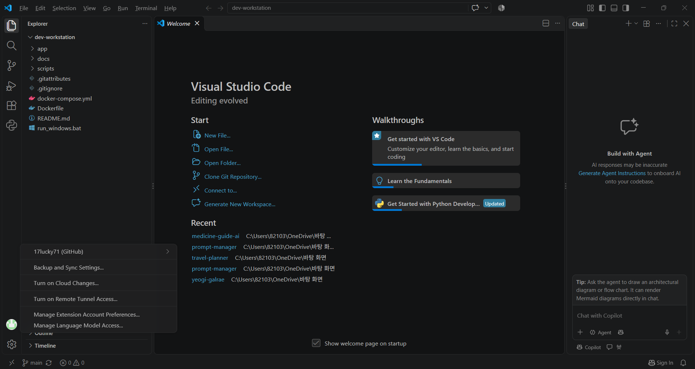

# 개발 워크스테이션 구축 (Codyssey 입학연수 · 개발 입문)

> 📄 **모든 명령의 실제 출력 로그는 [docs/evidence.md](docs/evidence.md)** 에 있습니다.
> 로그는 [`scripts/collect_evidence.sh`](scripts/collect_evidence.sh) 로 자동 수집했으며, 누구나 같은 명령으로 재현할 수 있습니다.
> 이메일·토큰 등 민감정보는 `****` 로 자동 마스킹됩니다.

### 재현 방법
```bash
git clone https://github.com/17lucky71/dev-workstation.git
cd dev-workstation
bash scripts/collect_evidence.sh      # Docker(OrbStack / Docker Desktop) 실행 상태에서
```

## 0) 프로젝트 개요
터미널·Docker·Git을 직접 세팅하고, NGINX 기반 커스텀 이미지를 만들어 포트 매핑, 바인드 마운트, 볼륨 영속성을 검증한다. 누가 실행해도 같은 결과가 나오는 **재현 가능한 실행 환경**을 만드는 것이 목표다.


### 핵심 검증 결과 요약
| 항목 | 결과 | 근거 |
|---|---|---|
| Docker 동작 | `Docker version 29.9.2`, `docker info` Server 응답, `Hello from Docker!` | [§4~5](docs/evidence.md#4-docker-설치-및-데몬-점검) |
| 커스텀 이미지 | `my-web:1.0` 빌드 성공 (nginx:alpine 기반) | [§7](docs/evidence.md#7-dockerfile-커스텀-이미지-빌드) |
| 포트 매핑 2회 | 8080, 8081 모두 `Hello from my custom NGINX container!` 응답 | [§8](docs/evidence.md#8-포트-매핑-2회) |
| 바인드 마운트 | 호스트 파일 수정 후 재빌드 없이 `v1 → v2` 반영 | [§10](docs/evidence.md#10-바인드-마운트-반영-호스트-변경-전후) |
| 볼륨 영속성 | `vol-test` 삭제 후 새 컨테이너에서 `persistent-data` 유지 | [§11](docs/evidence.md#11-docker-볼륨-영속성-컨테이너-삭제-전후) |
| 권한 변경 | 컨테이너에서 `-rw-r--r--` → `-rwxr-xr-x`(755), `drwxr-xr-x` → `drwx------`(700) | [§3](docs/evidence.md#3-권한-변경-변경-전후) |
| 환경 변수 | Compose로 `APP_ENV=prod`, 포트 9090 주입 확인 | [§13](docs/evidence.md#13-보너스-docker-compose) |

## 1) 실행 환경
| 항목 | 값 |
|---|---|
| OS | Windows 11 (10.0.26200) |
| Shell / Terminal | bash / Git Bash (MINGW64) |
| Container Runtime | OrbStack(macOS) / Docker Desktop(Windows) |
| Docker | Docker Desktop 4.97.0 (Engine 29.9.2, WSL 2 백엔드) |
| Git | 2.56.0.windows.4 |

## 2) 수행 체크리스트
- [x] 터미널 기본 조작 및 폴더 구성
- [x] 권한 변경 실습 (파일 1, 디렉토리 1)
- [x] Docker 설치/점검 (`--version`, `info`)
- [x] Docker 운영 명령 (`images`, `ps -a`, `logs`, `stats`)
- [x] hello-world / ubuntu 컨테이너 실행
- [x] Dockerfile 커스텀 이미지 빌드/실행
- [x] 포트 매핑 접속 (2회) — curl ✅ / 브라우저 스크린샷 대기
- [x] 바인드 마운트 반영
- [x] 볼륨 영속성
- [ ] Git 설정 + VSCode GitHub 연동 (git 설정 ✅ / VSCode 스크린샷 대기)
- [x] (보너스) Docker Compose / 환경 변수 / SSH 키

## 3) 저장소 구조
```
.
├── app/index.html        # 웹 서버 정적 콘텐츠
├── Dockerfile            # nginx:alpine 기반 커스텀 이미지
├── docker-compose.yml    # (보너스) web + helper
├── docs/evidence.md      # 자동 수집된 명령/출력 로그
├── docs/screenshots/     # 브라우저/VSCode 캡처
├── scripts/collect_evidence.sh
└── README.md
```

---

## 4) 터미널 조작 로그
```bash
$ pwd
$ mkdir -p ~/codyssey/practice && cd ~/codyssey/practice
$ touch empty.txt                # 빈 파일 생성
$ echo "hello" > note.txt
$ cat note.txt                   # 파일 내용 확인
$ cp note.txt note_copy.txt      # 복사
$ mv note_copy.txt renamed.txt   # 이동/이름변경
$ mkdir tmpdir && mv renamed.txt tmpdir/
$ ls -la                         # 숨김 파일 포함 목록
$ rm tmpdir/renamed.txt && rmdir tmpdir   # 삭제
$ ls -la
```

**절대 경로 vs 상대 경로**
- 절대 경로: 루트(`/`)부터 시작 → `/Users/me/codyssey/practice/note.txt`
- 상대 경로: 현재 위치 기준 → `./note.txt`, `../practice/note.txt`

## 5) 권한 실습
```bash
$ ls -l note.txt
$ chmod 755 note.txt
$ ls -l note.txt

$ mkdir perm_dir && ls -ld perm_dir
$ chmod 700 perm_dir
$ ls -ld perm_dir
```
**해석 규칙**: r=4, w=2, x=1을 더해 소유자/그룹/기타 순서로 표기
- `755` = rwx r-x r-x (소유자 전체, 나머지 읽기·실행)
- `644` = rw- r-- r-- (소유자 읽기·쓰기, 나머지 읽기)
- 디렉토리의 `x` = 그 안으로 들어갈(cd) 수 있는 권한

## 6) Docker 설치 및 점검
```bash
$ docker --version
$ docker info | head -n 20
```

## 7) 컨테이너 실행 실습
```bash
$ docker run hello-world

$ docker pull ubuntu
$ docker run -it --name my-ubuntu ubuntu bash
root@xxxx:/# ls
root@xxxx:/# echo "inside container"
root@xxxx:/# exit

$ docker start my-ubuntu
$ docker exec -it my-ubuntu bash   # 새 셸로 진입
$ exit                             # 컨테이너는 계속 실행됨
$ docker attach my-ubuntu          # 메인 프로세스(bash)에 붙음
$ exit                             # 메인 프로세스 종료 → 컨테이너도 종료
$ docker ps -a
```
**attach vs exec 관찰**: `exec`는 별도 프로세스를 띄우므로 빠져나와도 컨테이너가 유지되고, `attach`는 메인 프로세스에 직접 연결되므로 `exit` 시 컨테이너가 종료된다. (attach 상태에서 종료 없이 빠지려면 `Ctrl+P, Ctrl+Q`)

## 8) Docker 운영 명령
```bash
$ docker images
$ docker ps
$ docker ps -a
$ docker logs my-web-8080
$ docker stats --no-stream
$ docker stop my-web-8080 && docker ps -a
```

## 9) 커스텀 이미지 (Dockerfile)
- **베이스**: `nginx:alpine` (방식 A: 웹 서버 베이스 + 정적 콘텐츠 교체)

| 커스텀 포인트 | 목적 |
|---|---|
| `LABEL` | 이미지 이름/설명 메타데이터로 식별 용이 |
| `ENV APP_ENV=dev` | 실행 모드를 코드 밖 설정으로 분리 |
| `COPY app/` | 기본 NGINX 페이지를 내 콘텐츠로 교체 |
| `HEALTHCHECK` | 컨테이너 정상 응답 여부 자동 점검 |

```bash
$ docker build -t my-web:1.0 .
```

## 10) 포트 매핑 및 접속
```bash
$ docker run -d -p 8080:80 --name my-web-8080 my-web:1.0
$ curl http://localhost:8080
$ docker run -d -p 8081:80 --name my-web-8081 my-web:1.0
$ curl http://localhost:8081
```



**포트 매핑이 필요한 이유**: 컨테이너는 격리된 네트워크를 가지므로, 호스트 포트(8080)를 컨테이너 포트(80)에 연결해야 외부(브라우저)에서 접근할 수 있다. 호스트 포트만 바꾸면 같은 이미지를 여러 개 동시에 띄울 수 있다.

## 11) 바인드 마운트 반영
```bash
$ docker run -d -p 8082:80 --name my-web-bind \
    -v "$(pwd)/app:/usr/share/nginx/html" my-web:1.0
$ curl -s http://localhost:8082 | grep Version
$ sed -i '' 's/v1/v2/' app/index.html     # 호스트에서 파일 수정
$ curl -s http://localhost:8082 | grep Version
```

## 12) Docker 볼륨 영속성
```bash
$ docker volume create mydata
$ docker run -d --name vol-test -v mydata:/data ubuntu sleep infinity
$ docker exec vol-test bash -c "echo persistent > /data/hello.txt && cat /data/hello.txt"
$ docker rm -f vol-test
$ docker run -d --name vol-test2 -v mydata:/data ubuntu sleep infinity
$ docker exec vol-test2 cat /data/hello.txt
$ docker volume inspect mydata
```
**볼륨이란**: 컨테이너 생명주기와 분리되어 Docker가 관리하는 저장 공간. 컨테이너를 삭제해도 데이터가 남는다.

## 13) Git 설정 및 GitHub 연동
```bash
$ git config --global user.name "내이름"
$ git config --global user.email "****@****.com"
$ git config --global init.defaultBranch main
$ git config --list
```


**Git vs GitHub**: Git은 내 컴퓨터에서 변경 이력을 관리하는 **로컬 버전관리 도구**, GitHub는 Git 저장소를 원격에 올려 공유·리뷰·협업하는 **플랫폼**이다.

## 14) 트러블슈팅
### ① git push 시 `403` 오류
- **문제**: `git push -u origin main` 실행 시 `The requested URL returned error: 403`
- **원인 가설**: 저장소는 만들어졌지만, push에 사용한 인증 주체(GitHub App)에 이 저장소의 쓰기 권한이 없다.
- **확인**: GitHub → Settings → Applications → Installed GitHub Apps → Configure 에서 *Repository access* 가 `Only select repositories` 로 다른 저장소 1개만 선택되어 있음을 확인
- **해결**: `dev-workstation` 저장소를 추가 선택 후 Save → 재시도하니 `* [new branch] main -> main` 으로 push 성공
- **배운 점**: 403은 "인증은 됐지만 권한이 없다"는 뜻. 토큰/앱 권한 범위(scope)를 먼저 확인한다.

### ② GitHub 설정 저장 시 "What? Your browser did something unexpected" 오류
- **문제**: 앱 내장 브라우저 창에서 저장소 검색이 계속 로딩되고, Save 시 오류 페이지 표시
- **원인 가설**: 내장 브라우저가 GitHub 보안 요청(쿠키/CSRF 토큰)을 정상 처리하지 못함
- **확인**: 같은 URL(`github.com/settings/installations/...`)을 일반 Chrome에서 열어 비교 → 정상 동작
- **해결**: 일반 Chrome에서 설정 변경 및 저장 완료
- **배운 점**: 같은 요청이 환경에 따라 다르게 동작하면, 환경(브라우저/확장 프로그램)을 바꿔 원인 범위를 좁힌다.

### ③ 스크립트 실행 시 `docker: command not found`
- **문제**: `bash scripts/collect_evidence.sh` 실행 결과, Docker 관련 명령이 모두 `docker: command not found`
- **원인 가설**: Docker Desktop 설치 전에 열어 둔 Git Bash 창이라 PATH에 Docker 경로가 반영되지 않았거나, Docker Desktop이 아직 실행되지 않음
- **확인**: 같은 창에서 `docker --version` 실패 → Docker Desktop 실행(Engine running) 후 Git Bash를 새로 열어 `docker --version` 재확인
- **해결**: 새 터미널에서 스크립트 재실행
- **배운 점**: 프로그램 설치 후에는 터미널을 새로 열어야 환경 변수(PATH)가 갱신된다.

### ④ Windows에서 `chmod` 가 반영되지 않음
- **문제**: Git Bash에서 `chmod 755 note.txt`, `chmod 700 perm_dir` 실행 후에도 `ls -l` 결과가 그대로
- **원인 가설**: Windows NTFS는 리눅스식 r/w/x 권한 비트를 저장하지 않음
- **확인**: [evidence §3](docs/evidence.md#3-권한-변경-변경-전후) 의 변경 전/후 출력 비교
- **해결/대안**: 리눅스 컨테이너(alpine) 안에서 동일 실험을 수행해 권한 변경을 확인

### ⑤ Docker Desktop 설치 실패: `Virtual Machine Platform` 미활성화
- **문제**: Docker Desktop 설치 시 `Installation failed. One prerequisite is not fulfilled.` (Microsoft Store 설치도 `0x00000001` 오류로 실패)
- **원인 가설**: Docker(WSL 2 백엔드)가 사용하는 Windows 가상화 기능 `Virtual Machine Platform` 이 꺼져 있고, *Per-user* 설치는 관리자 권한이 없어 이를 켤 수 없음
- **확인**: 설치 프로그램 오류 메시지에서 원인 및 두 가지 대안(`wsl --install` 또는 All-users 설치) 확인
- **해결**: 설치 프로그램 재실행 → **All-users installation** 선택(관리자 승인) → `Installation succeeded` → 재부팅
- **배운 점**: 컨테이너는 리눅스 커널 기능을 쓰므로 Windows에서는 가상화(WSL 2) 기반이 먼저 필요하다. 설치 오류 메시지가 해결책을 알려 주는 경우가 많으니 끝까지 읽는다.

### ⑥ Compose 실행 시 `port is already allocated`
- **문제**: `docker compose up -d --build` → `Bind for 0.0.0.0:8080 failed: port is already allocated`
- **원인 가설**: 앞 단계에서 띄운 `my-web-8080` 컨테이너가 호스트 8080 포트를 이미 점유 중
- **확인**: `docker ps` 에서 `0.0.0.0:8080->80/tcp my-web-8080` 확인 ([evidence §8](docs/evidence.md#8-포트-매핑-2회))
- **해결**: 환경 변수로 호스트 포트만 변경 `WEB_PORT=9090 APP_ENV=prod docker compose up -d` → `curl localhost:9090` 응답, `printenv APP_ENV` = `prod` 확인 ([evidence §13](docs/evidence.md#13-보너스-docker-compose))
- **배운 점**: 호스트 포트는 하나의 프로세스만 점유할 수 있다. 포트를 코드가 아닌 환경 변수로 빼 두면 충돌 시 설정만 바꿔 해결할 수 있다.

### (참고) Windows Git Bash 경로 변환
- Git Bash는 `/data` 같은 경로를 `C:/Program Files/Git/data` 로 자동 변환해 `docker exec`·`-v` 가 실패할 수 있다.
- `export MSYS_NO_PATHCONV=1` 및 `cygpath -m` 으로 경로를 지정해 해결 (`collect_evidence.sh` 에 반영).

## 15) (보너스) Docker Compose
```bash
$ docker compose up -d --build
$ docker compose ps
$ docker compose logs helper     # web 서비스와 통신되는지 확인
$ WEB_PORT=9090 docker compose up -d   # 환경 변수로 포트 변경
$ docker compose down
```

## 16) 재현 시 주의사항
- macOS `sed -i ''` 는 Linux에서 `sed -i` 로 바꿔 실행
- sudo 권한이 없는 환경은 OrbStack(또는 Docker Desktop)을 먼저 실행한 뒤 진행
